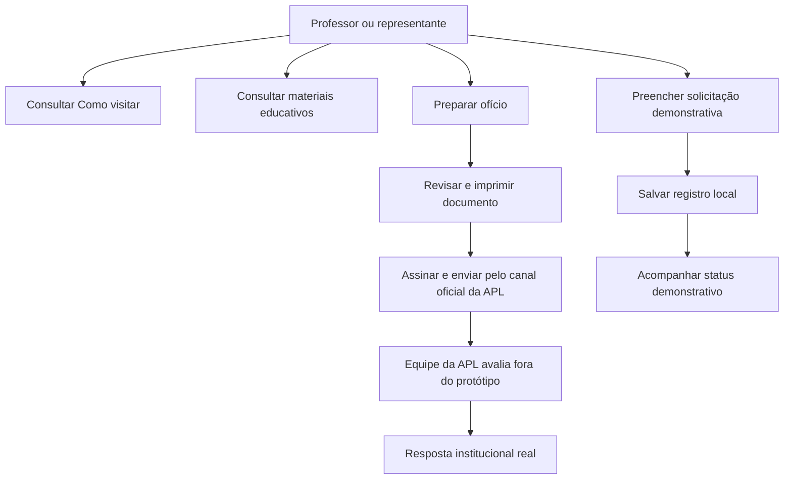
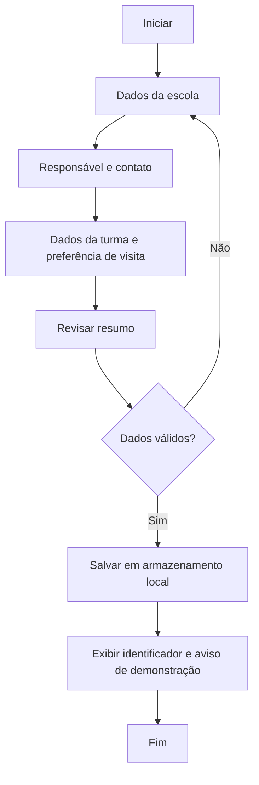
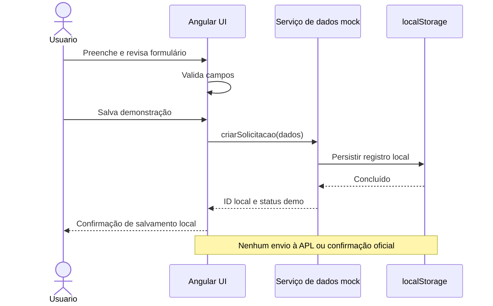
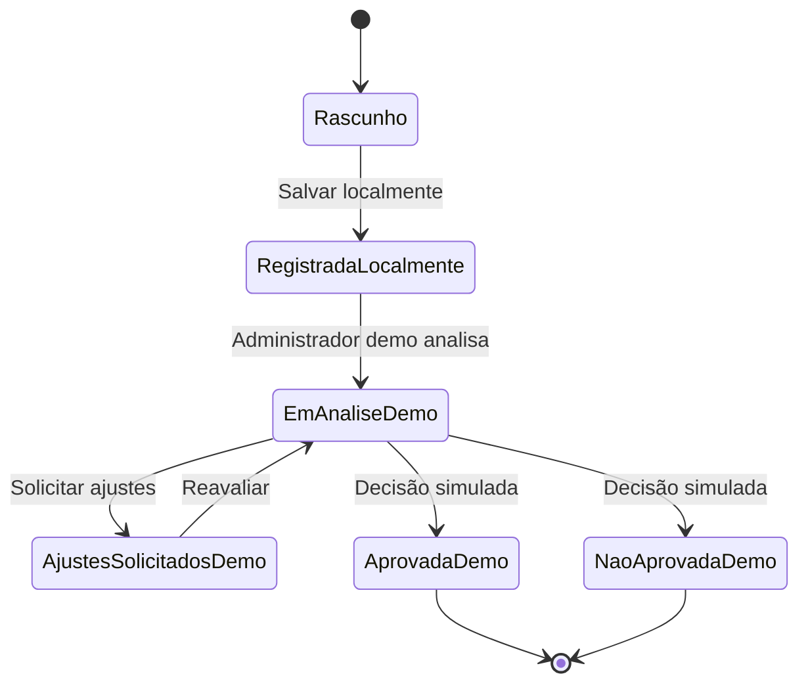
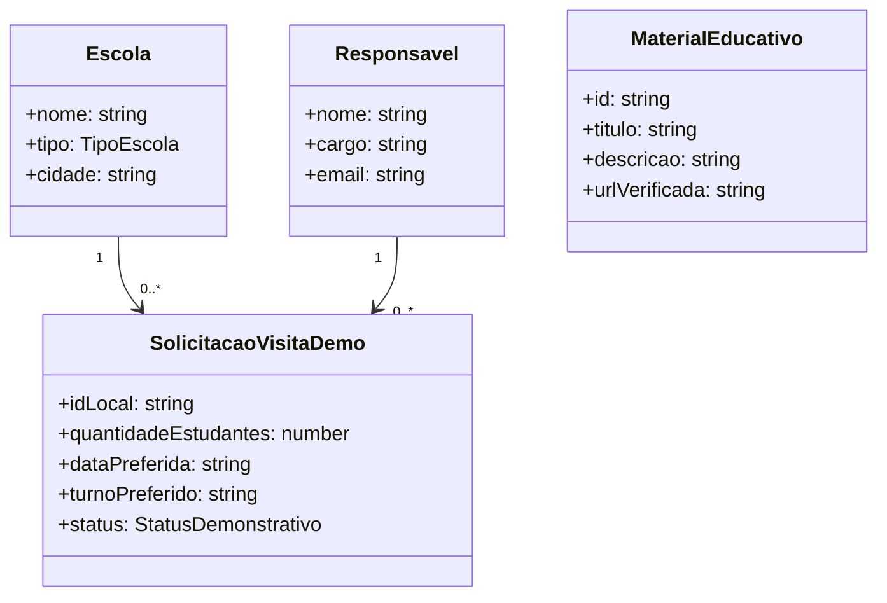

# APL Educa — Base de conhecimento e especificação funcional do MVP

> **Status:** consolidação de trabalho para o Codex, baseada no histórico recuperável do planejamento. **Não é uma transcrição literal integral** da resposta original “APL Educa — Especificação funcional do MVP”: os textos individuais de RF-01 a RF-30 e RN-01 a RN-10 não estavam disponíveis integralmente. A numeração abaixo é uma **reconstrução editorial para implementação**, a validar contra o texto original antes de tratá-la como contrato definitivo.
>
> **Regra para agentes de IA:** não completar lacunas com suposições; não alterar regras institucionais; registrar perguntas em `Decisões pendentes`; implementar apenas o escopo da sprint solicitada.

## 1. Identidade e propósito

- **Produto:** APL Educa — Visitas Escolares.
- **Instituição destinatária:** Academia Paraibana de Letras (APL), João Pessoa, Paraíba.
- **Objetivo:** orientar docentes e escolas na preparação de visitas, disponibilizar materiais educativos, auxiliar na elaboração do ofício e oferecer uma experiência prototipada de solicitação e acompanhamento; disponibilizar uma área administrativa demonstrativa para análise de solicitações.
- **Natureza atual:** MVP/protótipo. **Não é canal oficial de agendamento ou protocolo**, salvo aprovação e implantação formal pela APL.
- **Públicos:** professores/representantes escolares; equipe administrativa da APL; visitantes que consultam orientações e materiais.

## 2. Fonte da verdade e limites

**Precedência aprovada pelo responsável pelo projeto:** a seção 18, baseada na política oficial da APL, prevalece sobre as referências provisórias anteriores relativas à visitação. Essa aprovação não transforma o protótipo em canal oficial.

1. Este documento organiza o escopo funcional conhecido e distingue **políticas institucionais** de **comportamentos propostos para o protótipo**.
2. O canal oficial conhecido para solicitação é o envio de **ofício assinado em papel timbrado da escola** ao e-mail `academiadeletraspb@gmail.com`. O formulário digital **não substitui esse procedimento**.
3. Políticas oficiais incorporadas pela seção 18 (substituem o tratamento anterior como referências a confirmar):
   - Solicitar preferencialmente com **antecedência mínima de 7 dias úteis**.
   - **Escolas públicas:** gratuidade.
   - **Escolas particulares:** **R$ 5,00 por estudante**; professores e coordenadores acompanhantes isentos. Orientações de pagamento no e-mail de confirmação da APL, sem cobrança no protótipo.
   - **Capacidade ideal:** até **50 estudantes por turno**; grupos maiores devem ser desmembrados para datas ou turnos diferentes.
   - **Visitação:** segunda a sexta-feira, das **08h às 12h**, exceto feriados; chegada com pelo menos **10 minutos de antecedência**.
   - **Agendamento só está confirmado após manifestação da equipe da APL**.
4. Nunca apresentar uma solicitação salva em `localStorage` como recebida pela APL; nunca simular envio real de e-mail ou confirmação institucional.
5. Se houver divergência entre o protótipo e as regras atuais publicadas pela instituição, sinalizar a divergência e solicitar validação humana; não corrigir silenciosamente.

## 3. Visão do MVP

### 3.1 Áreas públicas

- **Início:** proposta da plataforma, benefícios, acesso às principais ações e orientações.
- **Como visitar:** instruções, requisitos, política de solicitação e perguntas frequentes.
- **Preparar ofício:** assistência ao preenchimento de um modelo formal para revisão, impressão, assinatura e encaminhamento pelo canal oficial.
- **Solicitar visita:** formulário demonstrativo em etapas; coleta, revisão e registro local dos dados, sem envio institucional.
- **Acompanhar solicitação:** consulta demonstrativa do registro e do status local.
- **Materiais educativos:** catálogo e leitura/acesso a conteúdos de preparação para a visita.

### 3.2 Área administrativa demonstrativa

- Painel de solicitações de exemplo.
- Listagem, busca/filtros básicos e detalhe da solicitação.
- Revisão e atualização de status **apenas em dados de demonstração**.
- Registro de observações administrativas demonstrativas.

### 3.3 Fora do escopo da primeira versão

- Integração real com e-mail, protocolo, agenda institucional ou banco de dados remoto.
- Autenticação real, perfis de acesso seguros ou armazenamento de dados pessoais em produção.
- Cobrança/pagamento online.
- Reserva ou confirmação automática de horário.
- Integrações externas não aprovadas pela APL.
- Publicação de informações institucionais não verificadas.

## 4. Atores e responsabilidades

| Ator                            | Objetivo                                                           | Limites                               |
| ------------------------------- | ------------------------------------------------------------------ | ------------------------------------- |
| Visitante público               | Ler orientações e materiais                                        | Sem ações administrativas             |
| Professor/representante escolar | Preparar ofício, simular pedido e acompanhar registro              | Não confirma agendamento              |
| Administrador demonstrativo     | Revisar registros simulados, ajustar status, registrar observações | Não representa decisão oficial da APL |
| Equipe da APL (mundo real)      | Receber ofício no canal institucional e confirmar ou não visita    | Processo externo ao protótipo         |

## 5. Jornada funcional

1. Usuário acessa a página inicial.
2. Lê **Como visitar** e compreende as condições e o canal oficial.
3. Consulta **Materiais educativos**, se desejar.
4. Abre **Preparar ofício**, preenche os campos, revisa e obtém documento para assinatura e envio oficial.
5. Opcionalmente, percorre **Solicitar visita** no protótipo; revisa informações e salva um registro local claramente rotulado como demonstração.
6. Em **Acompanhar solicitação**, consulta o status do registro demonstrativo.
7. Na área administrativa demonstrativa, o responsável visualiza o registro e altera seu status local.
8. A confirmação **real** só ocorre fora do sistema, pela APL, por seu canal institucional.

## 6. Requisitos funcionais — matriz reconstruída

> **Importante:** os IDs RF-01 a RF-30 existiam na especificação anterior, mas suas descrições literais não foram recuperadas. A matriz a seguir é uma **proposta de correspondência**, não uma afirmação de que os IDs originais tinham exatamente estes significados. Antes de usar esses números como rastreabilidade contratual, conferir a resposta original.

| ID provisório | Requisito para implementação do protótipo             | Critério observável                    |
| ------------- | ----------------------------------------------------- | -------------------------------------- |
| RF-01         | Exibir página inicial institucional do APL Educa      | Proposta e CTAs visíveis               |
| RF-02         | Disponibilizar navegação entre seções públicas        | Links e rotas funcionam                |
| RF-03         | Exibir orientações de visita escolar                  | Informações organizadas e legíveis     |
| RF-04         | Destacar procedimento oficial via ofício e e-mail     | Canal oficial explícito                |
| RF-05         | Apresentar condições e regras sujeitas à confirmação  | Sem prometer reserva automática        |
| RF-06         | Exibir perguntas frequentes sobre visitação           | Perguntas acessíveis                   |
| RF-07         | Disponibilizar formulário de preparação de ofício     | Campos editáveis                       |
| RF-08         | Validar campos essenciais do ofício                   | Erros específicos por campo            |
| RF-09         | Permitir revisão do ofício antes da saída             | Prévia legível                         |
| RF-10         | Gerar versão imprimível/copíavel do ofício            | Saída pronta para revisão e assinatura |
| RF-11         | Orientar assinatura, papel timbrado e envio oficial   | Instruções após geração                |
| RF-12         | Disponibilizar fluxo demonstrativo de solicitação     | Etapas navegáveis                      |
| RF-13         | Coletar identificação da escola no formulário         | Dados revisáveis                       |
| RF-14         | Coletar responsável e contato no formulário           | Dados revisáveis                       |
| RF-15         | Coletar informações da turma e quantidade             | Dados revisáveis                       |
| RF-16         | Coletar preferências de data/turno, sem garantir vaga | Aviso de não confirmação               |
| RF-17         | Validar dados por etapa                               | Avanço controlado                      |
| RF-18         | Permitir retorno a etapas sem perder dados da sessão  | Dados preservados                      |
| RF-19         | Exibir resumo para conferência                        | Resumo fiel aos campos                 |
| RF-20         | Salvar solicitação apenas como demonstração local     | Nenhuma requisição externa             |
| RF-21         | Gerar identificador local de acompanhamento           | Código exibido ao usuário              |
| RF-22         | Permitir consulta do registro demonstrativo           | Status local consultável               |
| RF-23         | Exibir catálogo de materiais educativos               | Lista navegável                        |
| RF-24         | Exibir detalhe ou acesso ao material disponível       | Sem links inventados                   |
| RF-25         | Exibir painel administrativo demonstrativo            | Resumo de registros locais             |
| RF-26         | Listar solicitações demonstrativas                    | Tabela/lista acessível                 |
| RF-27         | Filtrar ou buscar solicitações demonstrativas         | Resultados consistentes                |
| RF-28         | Exibir detalhes de uma solicitação                    | Dados completos do registro            |
| RF-29         | Permitir atualizar status de registro demonstrativo   | Estado persistido localmente           |
| RF-30         | Registrar observações administrativas demonstrativas  | Observações associadas ao registro     |

## 7. Regras de negócio — consolidação reconstruída

> A numeração RN-01 a RN-10 também é **provisória** até confronto com a especificação original.

| ID provisório | Regra                                                                                     | Natureza                                      |
| ------------- | ----------------------------------------------------------------------------------------- | --------------------------------------------- |
| RN-01         | Ofício timbrado, emitido e assinado pela direção ou coordenação, anexado ao e-mail        | Política oficial — seção 18                   |
| RN-02         | Agendamento solicitado exclusivamente por `academiadeletraspb@gmail.com`                  | Política oficial — seção 18                   |
| RN-03         | Recomendar no mínimo 7 dias úteis de antecedência                                         | Recomendação oficial, não bloqueio automático |
| RN-04         | Rede pública: entrada e mediação cultural gratuitas para estudantes e professores         | Política oficial — seção 18                   |
| RN-05         | Rede particular: R$ 5,00 por aluno; professores e coordenadores acompanhantes isentos     | Política oficial, sem checkout no protótipo   |
| RN-06         | Ideal de até 50 alunos por turno; acima disso, desmembrar para datas ou turnos diferentes | Política oficial — seção 18                   |
| RN-07         | Solicitação não equivale a visita confirmada                                              | Regra fundamental                             |
| RN-08         | Confirmação depende de resposta da equipe da APL                                          | Regra fundamental                             |
| RN-09         | Dados salvos no protótipo são locais e demonstrativos                                     | Regra técnica do MVP                          |
| RN-10         | Administração demonstrativa não representa decisão oficial                                | Regra técnica/comunicacional do MVP           |

### 7.1 Validação do protótipo conforme a seção 18

- Campos obrigatórios devem ser identificados visualmente e por tecnologias assistivas.
- Quantidade de estudantes deve ser número inteiro positivo.
- E-mail, quando solicitado, deve ter formato válido; não enviar mensagens.
- Datas sugeridas devem ser válidas e de segunda a sexta-feira; horários sugeridos entre 08h e 12h. Fechado nos feriados. Não há calendário homologado de feriados no protótipo: orientar conferência com a APL, sem inventar disponibilidade.
- **Não bloquear por antecedência inferior a 7 dias úteis**: trata-se de recomendação oficial, não de prazo rígido.
- Para totais superiores a 50, destacar a **necessidade de desmembramento** para solicitar datas ou turnos diferentes. Registrar o total para planejamento não equivale a reservar todo o grupo em um único turno. Não realizar divisão, reserva ou recusa institucional automática.
- Informar valores e isenções oficiais por rede, sem executar cobranças. A taxa geral de professor não se aplica ao professor/coordenador acompanhante de turma escolar.
- Ofício: exigir instituição, totais de alunos e acompanhantes, série/ano, data e horário sugeridos e telefone/WhatsApp direto do responsável; orientar assinatura pela direção ou coordenação.
- Novas solicitações demonstrativas coletam também telefone do responsável e total de acompanhantes. Registros anteriores continuam legíveis sem preenchimento retroativo inventado; campos ausentes permanecem não informados.

## 8. Gerador de ofício

### 8.1 Campos do modelo e dados exigidos pela política

- Nome oficial da escola.
- Rede/tipo de escola (pública ou particular).
- Cidade e data do documento.
- Nome e cargo de quem assinará.
- Telefone/WhatsApp direto do professor ou coordenador responsável pela visita.
- Número total de estudantes, total de professores/responsáveis acompanhantes e série/ano das turmas (obrigatórios pela seção 18).
- Data e horário sugeridos para a visitação (obrigatórios, sem garantia de disponibilidade).
- Objetivo pedagógico da visita (texto livre).

### 8.2 Estrutura textual de referência

**OFÍCIO Nº [número, se aplicável]**

**[Cidade], [data].**

À Academia Paraibana de Letras

**Assunto: Solicitação de visita escolar**

Prezados(as),

A [nome da escola], por meio de seu(sua) representante [nome/cargo da direção ou coordenação], solicita a apreciação de uma visita educativa à Academia Paraibana de Letras, para [quantidade] estudantes e [quantidade de acompanhantes] professores/responsáveis acompanhantes da(s) turma(s) [série/ano], preferencialmente em [data e horário]. A atividade tem como objetivo [objetivo pedagógico].

Colocamo-nos à disposição para adequações de data, horário e orientações necessárias, conforme disponibilidade e confirmação dessa instituição.

Atenciosamente,

[Nome e cargo]
[Assinatura]
[Telefone/WhatsApp direto do responsável pela visita e contatos adicionais da escola]

**Aviso obrigatório na interface:** “Este modelo deve ser revisado, colocado em papel timbrado, assinado e encaminhado ao canal oficial informado pela APL. Gerar o documento não agenda uma visita.”

### 8.3 Requisitos de qualidade

- Não inventar nome de dirigente, endereço postal ou número de protocolo.
- Permitir revisão humana antes da impressão.
- Se houver exportação PDF ou DOCX, tratá-la como tarefa de sprint específica, não como funcionalidade implícita já pronta.

## 9. Modelo de dados conceitual — proposta para mocks

```ts
export type TipoEscola = 'publica' | 'particular';
export type StatusDemonstrativo =
  | 'rascunho'
  | 'registrada_localmente'
  | 'em_analise_demo'
  | 'ajustes_solicitados_demo'
  | 'aprovada_demo'
  | 'nao_aprovada_demo';

export interface Escola {
  nome: string;
  tipo: TipoEscola;
  cidade?: string;
  contatoEmail?: string;
  contatoTelefone?: string;
}

export interface SolicitacaoVisitaDemo {
  idLocal: string;
  escola: Escola;
  responsavel: { nome: string; cargo?: string; email?: string; telefone?: string };
  quantidadeEstudantes: number;
  quantidadeAcompanhantes?: number; // Opcional na leitura de registros legados; exigido em novas entradas.
  turma?: string;
  dataPreferida?: string;
  turnoPreferido?: string;
  objetivoPedagogico?: string;
  status: StatusDemonstrativo;
  observacoesAdministrativas?: string[];
  criadoEm: string;
  atualizadoEm: string;
}
```

**Atenção:** nomes de campos e enum de status acima são **proposta técnica**, não modelo oficial previamente homologado. O status `aprovada_demo` jamais deve ser mostrado como confirmação real da APL.

## 10. Fluxos e modelagem textual

### 10.1 Caso de uso — visita escolar



### 10.2 Atividade — solicitação demonstrativa



### 10.3 Sequência — sem backend



### 10.4 Estados demonstrativos



> Estados e transições são um **desenho de demonstração**; não reproduzem necessariamente os estados originais da resposta anterior. A UI deve exibir o sufixo/aviso “simulação” de modo claro.

### 10.5 Diagrama de classes conceitual



## 11. Arquitetura e diretrizes técnicas

### 11.1 Stack definida

- Angular **22** (projeto observado na versão 22.2.3).
- TypeScript, componentes **standalone**, Angular Router, Reactive Forms e Signals quando adequados.
- SCSS; abordagem mobile-first.
- **Optimus UI** (`@openng/optimus-ui`) e ícones (`@openng/icons`) **somente após conferir as versões instaladas e APIs reais**.
- Dados de exemplo e persistência local (`localStorage`) no MVP; sem backend.
- Preservar a configuração de dependências que já passou por `npm audit` e `npm run build`; não alterar overrides sem justificativa.

### 11.2 Estrutura de pastas sugerida

```text
src/app/
  core/
    models/
    services/
  shared/
    components/
    ui/
  layout/
    header/
    footer/
  features/
    home/
    como-visitar/
    preparar-oficio/
    solicitar-visita/
    acompanhar-solicitacao/
    materiais-educativos/
    admin-demo/
  app.routes.ts
```

A estrutura é sugestão, não obrigação de refatorar tudo em uma única sprint.

### 11.3 Identidade visual de referência

| Token                   | Valor                                   |
| ----------------------- | --------------------------------------- |
| Marrom profundo         | `#513527`                               |
| Terracota               | `#A66A46`                               |
| Creme                   | `#F7F3EB`                               |
| Branco                  | `#FFFFFF`                               |
| Verde de apoio          | `#56745F`                               |
| Tipografia de títulos   | Libre Baskerville ou Cormorant Garamond |
| Tipografia de interface | Inter                                   |

- Responsividade para celular, tablet e desktop.
- Semântica HTML, navegação por teclado, foco visível, contraste e mensagens de validação acessíveis.
- Não criar componentes visuais com APIs do Optimus UI presumidas; verificar a biblioteca instalada.

## 12. Rotas propostas

| Rota                      | Tela                                | Escopo                                                          |
| ------------------------- | ----------------------------------- | --------------------------------------------------------------- |
| `/`                       | Início                              | Pública                                                         |
| `/como-visitar`           | Orientações                         | Pública                                                         |
| `/preparar-oficio`        | Gerador de ofício                   | Pública                                                         |
| `/solicitar-visita`       | Formulário demonstrativo            | Pública                                                         |
| `/acompanhar-solicitacao` | Consulta local demonstrativa        | Pública                                                         |
| `/materiais-educativos`   | Catálogo educativo                  | Pública                                                         |
| `/admin`                  | Painel administrativo demonstrativo | Somente demonstração; não tratar como rota protegida de verdade |

## 13. Plano de entrega por sprints

### Sprint 01 — Fundação visual e navegação

- Inspecionar projeto e dependências.
- Configurar tokens SCSS e integração visual com Optimus UI.
- Criar layout principal, header e footer responsivos.
- Criar Home e rotas com placeholders funcionais.
- Critério de aceite: navegação sem erros, interface responsiva, `npm run build` concluído.

### Sprint 02 — Como visitar e materiais

- Implementar conteúdo de orientação e FAQ.
- Criar catálogo de materiais com dados mock e sem links inventados.
- Destacar canal oficial e necessidade de confirmação.
- Critério de aceite: conteúdo legível, acessível, com políticas marcadas como sujeitas à confirmação.

### Sprint 03 — Preparação de ofício

- Formulário, validação, prévia e versão imprimível.
- Orientar assinatura e envio por e-mail oficial.
- Critério de aceite: nenhuma promessa de envio automático; documento editável/revisável.

### Sprint 04 — Solicitação demonstrativa

- Formulário multi-etapas, validação, revisão e armazenamento local.
- ID de acompanhamento demonstrativo.
- Critério de aceite: dados persistem localmente; nenhum envio remoto.

### Sprint 05 — Acompanhamento e administração demo

- Consulta de status local, painel, listagem, filtros, detalhe, alteração de status e observações.
- Critério de aceite: operações locais, rotulagem explícita como demonstração.

### Sprint 06 — Qualidade e preparação para validação

- Testes de fluxos e acessibilidade, revisão responsiva, textos e estados vazios.
- Revisão das políticas institucionais com a APL antes de qualquer publicação como serviço oficial.
- Critério de aceite: build e testes disponíveis aprovados; pendências documentadas.

## 14. Critérios de aceite globais

- [ ] O usuário consegue entender **como solicitar oficialmente** uma visita.
- [ ] O ofício pode ser preparado e revisado sem dados inventados.
- [ ] O sistema distingue claramente **registro demonstrativo** de **pedido oficial**.
- [ ] O formulário em etapas preserva dados e informa erros de validação.
- [ ] Acompanhamento e painel funcionam com dados locais de demonstração.
- [ ] Nenhuma interface afirma que uma visita foi confirmada pela APL sem confirmação externa.
- [ ] Não há cobrança, e-mail automático, autenticação real ou backend não autorizados.
- [ ] Layout funciona em celular, tablet e desktop.
- [ ] Controles são acessíveis por teclado e possuem rótulos.
- [ ] `npm run build` conclui sem erro após cada sprint.
- [ ] Decisões institucionais pendentes permanecem explicitamente sinalizadas.

## 15. Decisões pendentes e riscos

| Questão                               | Conduta até validação                                                                                 |
| ------------------------------------- | ----------------------------------------------------------------------------------------------------- |
| Política de visitação                 | Seção 18 prevalece, conforme aprovação do responsável; acompanhar futuras alterações da fonte oficial |
| Antecedência de 7 dias úteis          | Mostrar como recomendação, não bloqueio                                                               |
| Grupos acima de 50 estudantes         | Desmembramento exigido; protótipo não agenda nem divide grupos automaticamente                        |
| Taxa e isenções escolares             | Política oficial da seção 18, sem checkout; instruções de pagamento enviadas pela APL                 |
| E-mail de destino                     | Exclusivamente academiadeletraspb@gmail.com; nenhum envio pelo protótipo                              |
| Dados obrigatórios do ofício          | Definidos na seção 18; minuta ainda requer revisão e assinatura da direção ou coordenação             |
| Feriados e disponibilidade            | Fechado nos feriados; conferir a data com a APL, sem calendário ou agenda automática                  |
| Vocabulário oficial dos status        | Usar nomes claramente demonstrativos                                                                  |
| Dados pessoais em produção            | Não coletar/persistir remotamente sem requisitos de privacidade e segurança                           |
| Autorização da APL para uso público   | Protótipo não oficial até validação                                                                   |
| Descrição literal dos RF/RN originais | Comparar com resposta original antes de congelar baseline                                             |

## 16. Instruções mandatórias ao Codex

1. **Leia este documento antes de sugerir alterações**. Se houver `AGENTS.md`, leia-o também.
2. Não assuma que uma proposta técnica aqui equivale a decisão institucional homologada.
3. Não renomeie ou reinterprete os RF/RN como se fossem citações literais do documento original.
4. Antes de cada sprint, liste quais requisitos e critérios de aceite serão atendidos.
5. Implemente **somente a sprint solicitada**; não crie backend, autenticação, cobrança ou integrações por iniciativa própria.
6. Não invente datas disponíveis, materiais educativos reais, endereços, dirigentes, confirmação de agendamento ou links institucionais.
7. Não declare que `localStorage` envia ou protocola solicitações na APL.
8. Prefira mudanças pequenas, reversíveis e coerentes com o projeto existente.
9. Consulte versões e APIs reais dos pacotes antes de importar componentes.
10. Após mudanças, execute `npm run build` e os testes aplicáveis; relate falhas e arquivos modificados.
11. Quando o requisito estiver ambíguo, **pergunte**, documente a decisão e não improvise.
12. Preserve acessibilidade, responsividade e privacidade por padrão.

## 17. Como usar este arquivo

1. Colocar na raiz do repositório como `APL_EDUCA_ESPECIFICACAO_MVP.md` ou em `docs/`.
2. Referenciá-lo no `AGENTS.md` do projeto para que o Codex o consulte em cada tarefa.
3. Em cada prompt, mencionar explicitamente a sprint e os RFs relevantes.
4. Manter um registro de decisões e alterações com data, motivo e aprovação.
5. Substituir a matriz provisória RF/RN pela **redação original** assim que ela for fornecida, mantendo histórico das diferenças.

---

**Controle documental:** versão 0.2 — 23/10/2026. A versão 0.1, de 22/10/2026, consolidou o histórico recuperável com reconstruções técnicas identificadas. Nesta revisão, a seção 18 adicionada pelo responsável passa a prevalecer, com sua aprovação expressa, e as seções 2, 7, 8, 9 e 15 foram reconciliadas. A numeração RF/RN original continua pendente. **Não substituir a especificação original integral sem revisão humana.**

## 18. POLÍTICA DE VISITAÇÃO PARA GRUPOS ESCOLARES

Link oficial da APL: https://aplpb.com.br/visitacao/

Esta seção prevalece como regra de negócio para visitação, por aprovação expressa do responsável pelo projeto. Mantêm-se os limites de demonstração e as decisões pendentes de envio oficial e exportação definitiva.

A nossa instituição oferece visitas guiadas para escolas e demais pessoas interessadas, proporcionando uma experiência enriquecedora de conhecimento sobre nossa história, patrimônio e atividades. As visitas são realizadas nos seguintes horários:

Segunda a sexta-feira: das 08h às 12h
Feriados: Fechado

Taxa de Visitação
Público Geral R$ 10,00
Professores R$ 5,00
Estudantes de Escola Privada R$ 5,00
Estudantes de Escola Pública Gratuito

POLÍTICA DE VISITAÇÃO PARA GRUPOS ESCOLARES

A Academia Paraibana de Letras (APL) tem o compromisso de promover a literatura, a cultura e a história paraibana, democratizando o acesso ao seu espaço institucional e acervo. Visando a sustentabilidade de suas ações culturais e a organização do espaço, estabelecemos as seguintes diretrizes para as visitas de instituições de ensino:

1. Das Escolas Públicas (Gratuidade)
   Fica assegurada a gratuidade total na entrada e na mediação cultural para turmas de estudantes e professores da rede pública de ensino (municipal, estadual e federal).

2. Das Escolas Particulares (Taxa de Visitação)
   Para grupos oriundos da rede privada de ensino, será cobrada uma taxa de R$ 5,00 por aluno.

Os professores e coordenadores acompanhantes da turma são isentos da taxa.

As orientações para o pagamento da taxa de visitação serão enviadas no e-mail de confirmação do agendamento.

3. Da Capacidade e Limitação de Espaço
   Devido às limitações físicas e para garantir uma experiência confortável e segura a todos, o número ideal é de até 50 alunos por turno de visitação.

Escolas que possuam turmas que excedam esse quantitativo deverão desmembrar o grupo e solicitar o agendamento de datas ou turnos diferentes.

4. Requisitos para o Agendamento (Ambas as Redes)
   Para garantir a segurança, o conforto e a qualidade da recepção, todas as visitas de grupos escolares — sejam públicas ou particulares — devem ser planejadas com antecedência, cumprindo obrigatoriamente os seguintes critérios:

Solicitação por e-mail: O pedido de agendamento deve ser encaminhado exclusivamente para o endereço eletrônico: academiadeletraspb@gmail.com

Envio de ofício: O e-mail deve conter, em anexo, um ofício timbrado, emitido e assinado pela direção ou coordenação da escola responsável.

Informações necessárias no ofício:

Nome completo da instituição de ensino;

Número total de alunos e de professores/responsáveis acompanhantes;

Série/ano das turmas;

Data e horário sugeridos para a visitação;

Contato direto (telefone/WhatsApp) do professor ou coordenador responsável.

5. Orientações Gerais
   As visitas dependem estritamente da confirmação de disponibilidade da APL, que responderá ao e-mail formalizando o agendamento.

Recomenda-se que a solicitação seja feita com, no mínimo, 7 (sete) dias úteis de antecedência.

No dia da atividade, o grupo deverá chegar com pelo menos 10 minutos de antecedência em relação ao horário marcado.

Para dúvidas ou mais informações, entre em contato através de nosso e-mail oficial.
